 <picture> <source media="(prefers-color-scheme: light)" srcset="light_animated.svg"> <source media="(prefers-color-scheme: dark)" srcset="dark_animated.svg">  </picture>    
 
 <h2 align="center">Atividade de Contribuições</h2> 
 <picture> <source media="(prefers-color-scheme: dark)" srcset="https://github.com/allissonvn/allissonvn/raw/output/github-contribution-grid-snake-dark.svg"> <source media="(prefers-color-scheme: light)" srcset="https://github.com/allissonvn/allissonvn/raw/output/github-contribution-grid-snake.svg">  </picture> 
 
 <h2 align="center">Contato</h2> 

    

